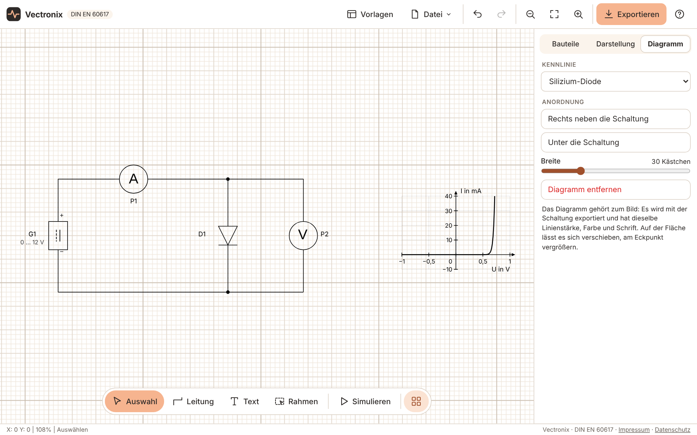
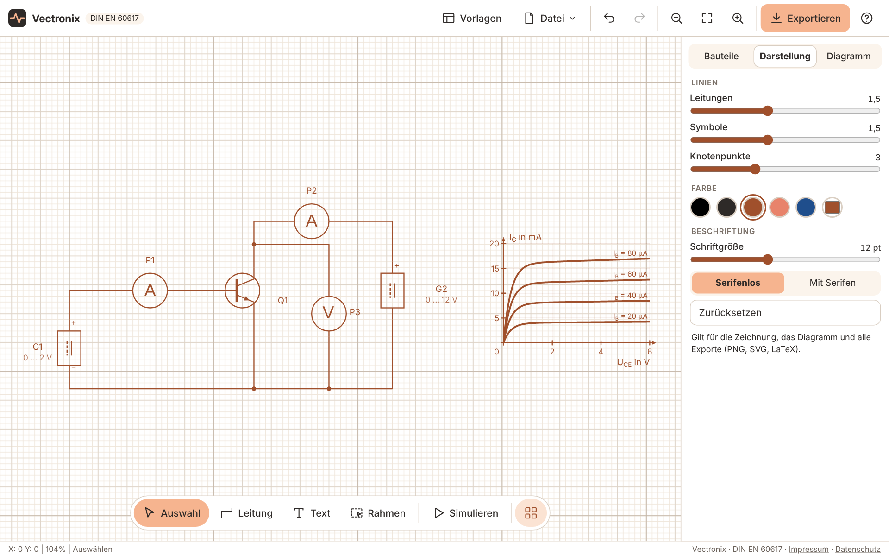
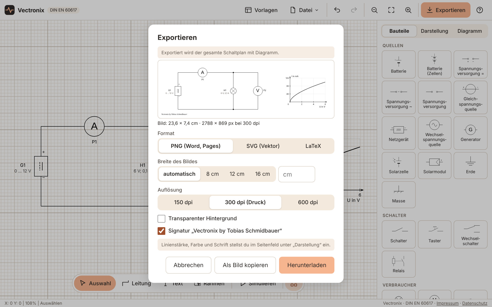
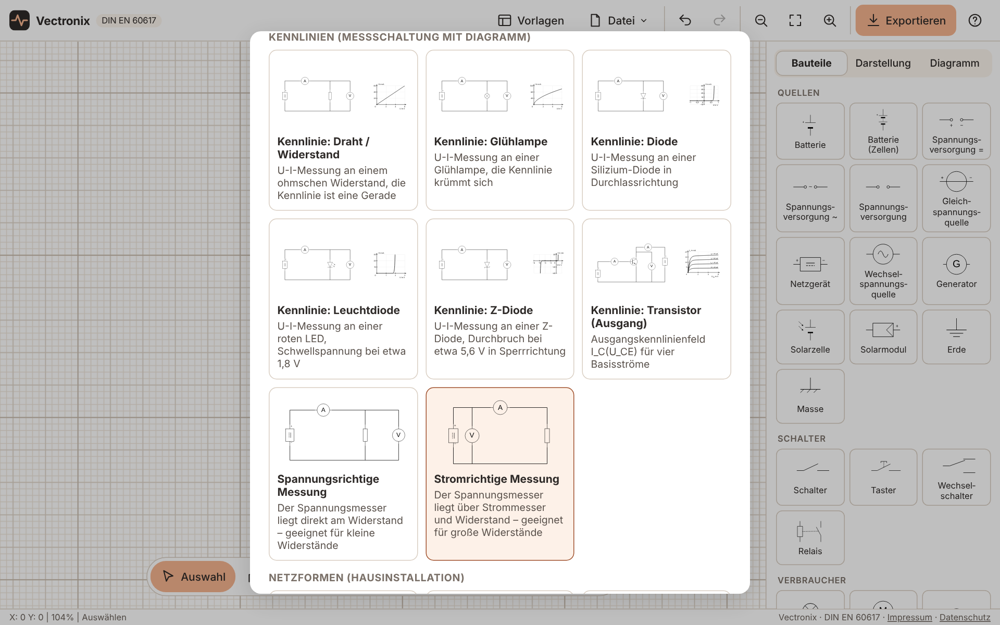

# Vectronix

**Schaltpläne nach DIN EN 60617 für Unterricht und Arbeitsblätter. Läuft im Browser, ohne Anmeldung, ohne Server.**

[**Vectronix im Browser öffnen**](https://tjrschmidbauer.github.io/Vectronix/) · [Impressum](https://schmidbauer.io/impressum/) · [Datenschutz](https://schmidbauer.io/datenschutz/)

Vectronix zeichnet Schaltpläne mit genormten Symbolen und liefert Bilder, die ohne Nacharbeit in ein Arbeitsblatt, eine Folie oder eine Prüfung passen. Linienstärke, Farbe und Beschriftung sind einstellbar, das Bild bekommt eine Breite in Zentimetern, und zu den Messschaltungen gibt es die passende Kennlinie im selben Bild.

## Auf einen Blick

| Bereich | Was Vectronix kann |
|---|---|
| Zeichnen | 48 genormte Bauteile, Leitungen rasten am 8er-Karo ein, Knotenpunkte entstehen automatisch, Mehrfachauswahl mit Rahmen |
| Vorlagen | 27 fertige Schaltungen: Reihe, Parallel, gemischt, mit Schalter, Kondensator, Widerstand, Messschaltungen, Netzformen |
| Kennlinien | U-I-Diagramm für Draht, Glühlampe, Diode, LED, Z-Diode und Transistor, verschiebbar und Teil des Bildes |
| Darstellung | Linienstärke für Leitungen und Symbole, Farbe, Schriftgröße, Schriftart |
| Export | PNG (150 bis 600 dpi), SVG, LaTeX (circuitikz), Breite in cm, Vorschau, Signatur abschaltbar |
| Unterricht | Gleichstrom-Simulation, Arbeitsblatt-Modus mit Lücken, Teilen per Link und QR-Code |
| Geräte | Tablet-tauglich, als App installierbar, funktioniert offline |

## Bilder, die in Dokumente passen

Im Seitenfeld unter **Darstellung** stellst du Linienstärke, Farbe und Schrift ein. Die Einstellungen gelten für die Schaltung, das Diagramm und jeden Export.

Beim Exportieren legst du die Breite in Zentimetern fest. Die Vorschau zeigt das fertige Bild, darunter stehen Größe in cm und Pixeln. Bei LaTeX wird die Breite über `scale` gesetzt.

## Vorlagen

Unter **Vorlagen** liegen die gängigen Schaltungen aus dem Unterricht. Eine Vorlage wird in der Mitte der Ansicht eingefügt und ist danach ausgewählt, lässt sich also gleich verschieben. Die Kennlinien-Vorlagen bringen das Diagramm mit.

| Gruppe | Vorlagen |
|---|---|
| Grundschaltungen | Reihenschaltung, Parallelschaltung, Spannungsteiler, Wechselschaltung, RC-Glied, Einweggleichrichter, Transistor als Schalter |
| Schalter, Kondensator, Widerstand | Reihe mit Schalter und Lampe, Parallel mit Schalter je Zweig, Widerstände in Reihe, Widerstände parallel, gemischte Schaltung, Kondensatoren in Reihe und parallel, LED mit Vorwiderstand |
| Kennlinien | Draht oder Widerstand, Glühlampe, Diode, Leuchtdiode, Z-Diode, Transistor (Ausgangskennlinien), spannungsrichtige und stromrichtige Messung |
| Netzformen | TN-C, TN-S, TN-C-S, TT, IT (DIN VDE 0100-100) |

Die Kennlinien sind aus typischen Werten berechnet (zum Beispiel Silizium-Diode mit Knick bei etwa 0,7 V) und zeigen den Verlauf, keine Messwerte.

## Für Lehrkräfte

* **Arbeitsblatt in zwei Minuten:** Vorlage öffnen, Werte eintragen (Doppeltippen), einzelne Bauteile als *Lücke* markieren, *Exportieren*, Fassung *Aufgabe* und danach *Lösung*. Oder *Als Bild kopieren* und direkt in Word einfügen.
* **Im Unterricht:** *Simulieren* starten und Schalter live umlegen. Mit *Datei, Teilen* einen QR-Code an die Wand werfen. Die Klasse arbeitet mit einer eigenen Kopie weiter.
* **In mebis oder einer anderen Lernplattform:** Den Teilen-Link als Link im Kurs anlegen. Wer ihn öffnet, bekommt genau diese Schaltung.
* **Datenschutz:** keine Anmeldung, keine Cookies, keine fremden Server, Speichern nur nach Zustimmung.

## Loslegen

**Online:** [tjrschmidbauer.github.io/Vectronix](https://tjrschmidbauer.github.io/Vectronix/) öffnen.

**Lokal:** Repository als ZIP laden oder klonen und `index.html` im Browser öffnen. Es gibt keinen Build-Schritt. Der Offline-Modus (Service Worker) braucht http oder https, zum Beispiel `python3 -m http.server 8080` im Projektordner.

**Eigene Kopie auf GitHub Pages:** In *Settings, Pages* als Quelle *Deploy from a branch* wählen, Branch `master` und Ordner `/ (root)`. Nach ein bis zwei Minuten ist die Seite erreichbar. Die Datei `.nojekyll` sorgt dafür, dass GitHub die Dateien unverändert ausliefert.

### Der erste Schaltplan

1. **Bauteil setzen:** Im Seitenfeld unter *Bauteile* antippen und auf die Fläche tippen (mehrfach möglich, *Fertig* beendet) oder direkt auf die Fläche ziehen. Schneller Start: *Vorlagen*.
2. **Leitungen ziehen:** Vom Anschluss eines Bauteils aus ziehen, oder das Werkzeug *Leitung* (`W`) nutzen.
3. **Bearbeiten:** Antippen wählt aus, die Leiste unten bietet *Bearbeiten*, *Drehen*, *Duplizieren*, *Löschen*. Doppeltippen öffnet Bezeichnung und Wert, zum Beispiel `4,5 V`, `1 kΩ` oder `3,5 V; 0,2 A`. Diese Werte nutzt auch die Simulation.
4. **Darstellung:** Im Seitenfeld Linienstärke, Farbe und Schrift einstellen.
5. **Diagramm:** Im Reiter *Diagramm* eine Kennlinie wählen. Sie erscheint neben der Schaltung und ist Teil des Bildes.
6. **Exportieren:** *Exportieren* für PNG, SVG oder LaTeX mit Breite in cm. *Export-Bereich wählen* (`Umschalt+R`) exportiert nur einen Ausschnitt.

### Tastenkürzel

| Taste | Funktion |
|---|---|
| `V` / `W` / `T` / `M` | Auswahl / Leitung / Text / Rahmen |
| `Leertaste` | Simulation starten oder beenden |
| `Umschalt+R` | Export-Bereich aufziehen |
| `R` | Auswahl drehen |
| `Entf` | Auswahl löschen |
| `Strg+C` / `Strg+X` / `Strg+V` | Kopieren / Ausschneiden / Einfügen |
| `Strg+A` / `Strg+D` | Alles auswählen / Duplizieren |
| `Strg+Z` / `Strg+Y` | Rückgängig / Wiederholen |
| `Strg+E` / `Strg+Umschalt+C` | Exportieren / Als Bild kopieren |
| `Strg+S` / `Strg+O` | Speichern / Laden |
| `F`, `+`, `-`, `0` | Alles anzeigen, Zoom |
| `?` | Hilfe |

### Häufige Fragen

* **Mein Plan ist nach dem Neuladen weg?** Der Autosave nutzt den Browserspeicher und läuft nur nach Zustimmung. Im privaten Modus oder nach dem Löschen von Websitedaten geht er verloren. Wichtige Pläne zusätzlich als Datei (`.vectronix`) speichern.
* **GitHub Pages zeigt einen 404-Fehler?** Prüfen, ob in *Settings, Pages* der Branch `master` und `/ (root)` gewählt sind und `index.html` im Hauptordner liegt.
* **Der LaTeX-Export kompiliert nicht?** Es wird das Paket `circuitikz` gebraucht. Polarität und Symbolgrößen im Ergebnis kontrollieren.

## Bauteile

| Gruppe | Bauteile |
|---|---|
| Quellen | Batterie (auch aus mehreren Zellen), Spannungsversorgung (allgemein, Gleich-, Wechselspannung, wie im Schaltzeichenblatt des ISB Bayern), Gleichspannungsquelle nach DIN EN 60617-2, Netzgerät, Wechselspannungsquelle, Generator, Solarzelle, Solarmodul, Erde, Masse |
| Schalter | Schalter, Taster, Wechselschalter, Relais |
| Verbraucher | Lampe, Motor, Klingel, Lautsprecher |
| Passiv | Widerstand, Potentiometer, Fotowiderstand (LDR), Heißleiter (NTC), Kondensator, Elko, Spule, Spule mit Eisenkern, Sicherung |
| Halbleiter | Diode, LED, Z-Diode, Transistor npn und pnp |
| Messen und Pfeile | Spannungsmesser, Strommesser, Spannungspfeil, Strompfeil |
| Hausinstallation | Drehstromquelle (Trafo in Sternschaltung), Verbraucher, Drehstromverbraucher mit Körper |
| Sonstige | Transformator (mit und ohne Eisenkern), Operationsverstärker, UND-, ODER- und NICHT-Gatter |

## Datenschutz

* Keine Cookies, kein Tracking, keine Analyse- oder Werbedienste, keine Anmeldung.
* Keine Daten an Dritte: Vectronix lädt nur eigene Dateien. Eine Content-Security-Policy blockiert Verbindungen zu fremden Servern (keine CDNs, keine Google Fonts, keine eingebetteten Fremdinhalte). Links geben keine Herkunftsadresse weiter.
* Speichern nur mit Zustimmung: Bei jedem Start fragt Vectronix, ob Schaltplan, Einstellungen, Zwischenablage (`localStorage`) und die App-Dateien für den Offline-Betrieb (Service-Worker-Cache) lokal im Browser gespeichert werden dürfen. Vor der Entscheidung wird nichts gelesen oder gespeichert. Bei „Ablehnen“ werden vorhandene Vectronix-Daten gelöscht, und Vectronix arbeitet nur im Arbeitsspeicher. Speichern als Datei, Export und Teilen per Link funktionieren weiterhin.
* Teilen ohne Server: Ein Teilen-Link enthält die Schaltung selbst, hinter dem `#`, das der Browser nicht an den Server schickt. Der QR-Code entsteht im Browser.
* Beim Aufruf über GitHub Pages gelten für den Server die [Datenschutzbestimmungen von GitHub](https://docs.github.com/de/site-policy/privacy-policies/github-general-privacy-statement).

## Entstehung und KI

Vectronix ist ein privates Projekt von Tobias Schmidbauer. Konzept, Anforderungen und didaktische Entscheidungen stammen von ihm. Code und Teile der Texte entstehen mit Unterstützung von KI-Assistenten (Claude von Anthropic), die auch in den Commits als Mitautor vermerkt sind. Änderungen gehen erst nach seiner Freigabe in den Hauptzweig. Die Screenshots in diesem README stammen aus der laufenden Anwendung.

Die Farben folgen dem Markenhandbuch von [schmidbauer.io](https://schmidbauer.io/): Creme, Kohle, Apricot und Ziegelrot.

Diese Seite ist ein privates Angebot und steht in keinem Zusammenhang mit meinem Dienstherrn oder einer Schule. Alle Inhalte, Einschätzungen und Meinungen sind ausschließlich meine persönliche, private Sicht.
